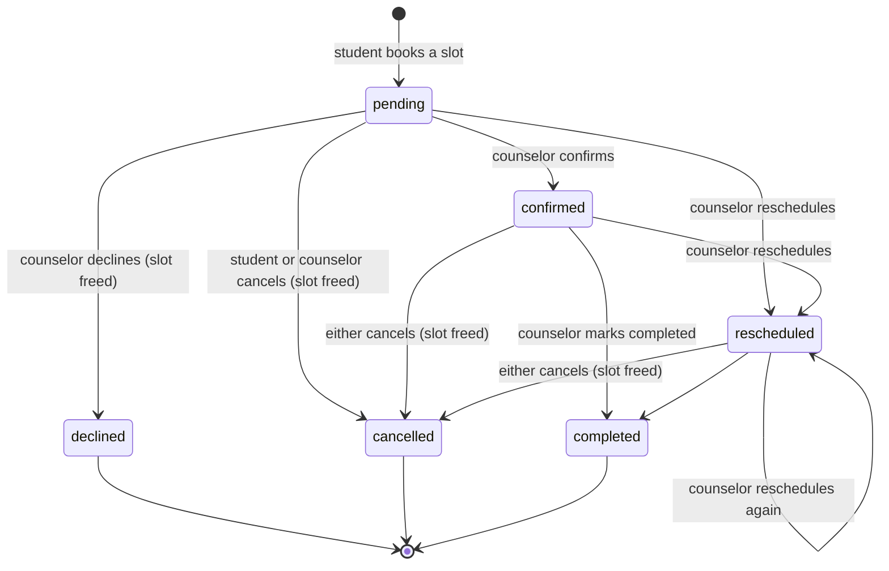

# State machines in Mind Bridge

Most of this app is "a thing that is in one state and can move to some others". This page lists every one of them,
where its rules live, and whether they are written down in one place. **If you add a status, a step or a flag, find
its row here first.** The rule for all of them: one pure, tested module owns the states and the allowed moves; screens
and the data layer ask it, and never compare status strings themselves.

## Made explicit

### Appointment lifecycle: [`client/src/utils/appointmentLifecycle.ts`](../client/src/utils/appointmentLifecycle.ts)

Before, six screens each read the free-text `status` their own way (substring checks in four different spellings), and
what a counselor or student could do was decided by which buttons an `if` chain happened to render. Now there is one
reader (`appointmentPhase`), one table of who can do what (`actionsFor`), one rule for when a slot is freed
(`releasesSlot`) and one rule for which moves are legal (`canMove`).

| Who | From | Can do |
|---|---|---|
| Counselor | pending | Confirm, Reschedule, Decline |
| Counselor | confirmed, rescheduled | Mark completed, Reschedule, Cancel session |
| Student | pending, confirmed, rescheduled | Cancel booking (the only thing `firestore.rules` lets a student write) |
| Anyone | completed, declined, cancelled | nothing |

- **Stale clicks are refused.** `updateAppointmentStatus` reads the current status first. If a counselor presses
  Confirm on a booking the student cancelled a moment ago, they get "This appointment was just changed by someone
  else" and nothing is overwritten. If the read fails, or the stored status is unrecognised, the write goes ahead.
- **Unknown status text** (hand-written legacy rows) reads as `other`: shown as written, offered no actions, never blocked.
- Tests: `appointmentLifecycle.test.ts` (the table, including a check that it agrees with `firestore.rules`),
  `api.test.ts` (stale clicks), `e2e/appointment-lifecycle.spec.ts`.

## Already explicit (leave alone)

| Machine | States | Where | Notes |
|---|---|---|---|
| Account | active, pending-approval, deactivated, unverified, unavailable | `utils/accountStatus.ts`, set by `AuthProvider` | Mirrors `firestore.rules`; `unavailable` means the profile read failed, so the role is not guessed |
| Case follow-up | overdue, today, upcoming, none | `utils/followUp.ts` | Derived from the date and the case status; a reviewed case has none |
| High-risk alert delivery | unalerted → claimed → sent, or released on failure | `client/api/_alertCore.ts` (`claimAlert` / `releaseAlert`, `alertSentAt`) | The claim makes the browser call and the 10-minute sweep safe to run twice |
| Risk level | low, medium, high (derived, never trusted from the client) | `utils/scoring.ts`, `utils/risk.ts`, `api/_alertCore.ts` | Only ever raised on the staff side |
| Breathing exercise | idle and the pattern phases | `components/student/BreathingPacer.tsx` | Typed `BreathingPhase` |

## Small and fine as they are

| Machine | States | Where | Why no change |
|---|---|---|---|
| Case status | open, reviewed, escalated | `types/models.ts`, rules | Any move between them is allowed and intended, so there is no rule to centralise |
| Availability slot | open ⇄ booked (`isBooked`) | `api.ts` `bookAppointment`, `releasesSlot` | Coupled to the appointment lifecycle above: booking sets it, decline or cancel clears it. Known race on double booking is documented in `bookAppointment` and `ARCHITECTURE.md` |
| Booking steps | pick counselor → pick time | `components/appointments/BookingFlow.tsx` | The step is derived from two values and cannot be in an impossible state |
| Cookie notice, offline banner, service worker | shown / hidden | `CookieConsent`, `OfflineBanner`, `registerServiceWorker` | One boolean each |

## Implicit and deliberately not touched yet

These work and are covered by tests, but their state is spread over several booleans. Changing them means editing
many screens, which is the wrong trade a few days before a presentation. They are the next candidates.

| Machine | Today | Proposed |
|---|---|---|
| Data loading on a screen | `loading` plus `loadFailed` or `loadError` booleans on the student dashboard, appointments, staff dashboard, settings and availability | One `LoadState = idle \| loading \| failed \| ready` helper with the shared `LoadError` banner, so "loading and failed at once" cannot exist |
| Sign-in session | `currentUser`, `userRole`, `userData`, `accountStatus` and `loading` in `AuthProvider` | One discriminated union: `loading \| signed-out \| signed-in(account status)` |
| Check-in flow | `qIndex`, `mode`, `surveyCompleted`, `submittingSurvey`, `submitError`, `lastSubmission` in `StudentDashboard.tsx` | A reducer with `answering → submitting → result` and `error`, extracted from the 1,200-line page |
| WHO-5 card | `open`, `saving`, `error`, `loading` | Same as the check-in flow |

## Adding to a machine

1. Add the state to the module that owns the machine, plus its row in the table above.
2. Add the move to the transition table and its test. Never add a string comparison in a screen.
3. If the data lives in Firestore, change `firestore.rules` too and its test in `backend-tests/rules/`. The rules are the
   real gate; the TypeScript tables only decide what to show and what to refuse early.
